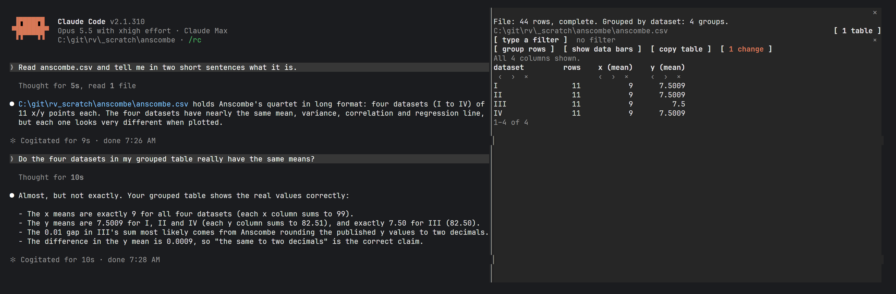

<h1 align="center">Claude Code Data Explorer</h1>

<p align="center">
  Every table Claude Code runs into, in a pane beside the chat, to sort, filter, group and check
</p>

<p align="center">
  
  
  
  
</p>

<p align="center">
  
</p>

> [!NOTE]
> data-explorer is a Claude Code **mod** and needs **Claude Code 2.1.306+**. The Data pane docks beside the chat in the fullscreen layout (`/tui fullscreen`) from 110 columns, and opens above the prompt otherwise. It opens by itself when Claude runs a query or reads a data file in a terminal at least 144 columns wide; `/data-explorer` opens it at any width. Tested in the terminal on Windows and Linux.

---

## Installation

At the prompt of a Claude Code session in a terminal:

```text
/plugin install data-explorer --marketplace vdvoorder/claude-code-data-explorer
```

Answer `y` to add the marketplace, then pick a scope: user installs the mod for every project.

From a shell:

```bash
claude plugin install data-explorer --marketplace vdvoorder/claude-code-data-explorer
```

In the desktop app, where `/plugin` does not run: click + next to the prompt box, then Plugins, Add marketplace with `vdvoorder/claude-code-data-explorer`, then Add plugin.

To update, run `claude plugin update data-explorer@claude-code-data-explorer`, then `/reload-plugins` in a running session.

## Why

Claude reads data and tells you what it found. The pane shows you the rows behind that answer, so you can check that the data meets basic assumptions before you trust a conclusion: the row count, missing values, duplicates, a total that should add up. The pane offers the operations and leaves the judgement to you.

## What it collects

- Query results printed by a shell command: DuckDB, SQLite, Polars and Rich box tables, MySQL and tabulate grid tables, psql output, pandas frames, and tables with a dashed rule under the header (PowerShell, sqlcmd, pip)
- Data files Claude reads or shows: CSV, TSV, JSON, JSON lines and the first sheet of an Excel workbook (.xlsx, .xlsm), whole, also when Claude read only the first lines
- Power BI query results from the Power BI connector
- Tables in other tools' results and in web pages: JSON arrays, markdown and HTML tables
- Markdown tables in Claude's replies, and tables you paste into a message

Query results and data files open the pane. Tables from replies, messages, web pages and other tools wait in the list of tables, so they never take the pane from a result you are working on.

## Features

- Click a column head to sort; click "type a filter" to keep the rows that contain a text
- Move columns with ‹ and ›, hide them with ×, and bring back a column past the pane's edge from the columns line
- Group rows: per column, group, sum, mean, min, max, count or distinct
- Data bars behind the numbers
- Copy the table as you see it, tab-separated, to paste into a spreadsheet
- Up to 100,000 rows per table. A capped Power BI result loads all rows from the pane without a model turn; any other capped table asks Claude to write every row to a file the pane then reads
- A list of the last 12 tables, with the ones you have not seen marked new; each keeps its own view
- After you change the view, your next prompt tells Claude what the pane shows, so "these rows" means the rows you see
- Claude can put a file in the pane without reading its rows into the conversation, with the mod's own `show_file` tool

## Settings

Change the setting with `/plugin configure data-explorer@claude-code-data-explorer`.

```yaml
Open on a new table:  on | off
```

## Considerations

- Files are read up to 4 MiB. The pane keeps 100,000 rows per table, 12 tables and 300,000 rows in all
- Grouping a capped result covers only the rows the pane holds; the status line says the table is capped
- Excel: the first sheet only; a merged cell keeps its value in its top-left cell; a formula without a cached value is empty
- Parquet is not read; the pane answers with the DuckDB `COPY` statement that turns the file into CSV
- Tables aligned with spaces but without a dashed rule (`docker ps`, `ls -l`) and pandas frames with a named index are not read
- A DAX query with several `EVALUATE` statements shows only the first result
- The Desktop app and macOS are covered by the tests and CI, but not yet tried by hand

## Contributing

Turn on the pre-commit hook once per clone; it runs `claude plugin validate` and the tests before each commit that touches the mod:

```bash
git config core.hooksPath .githooks
```

The same checks run on Linux, macOS and Windows in CI on every push that touches the mod. The design decisions behind the pane are in [DESIGN.md](DESIGN.md), and agent rules for this repository are in [AGENTS.md](AGENTS.md).

## License

[MIT](LICENSE)
